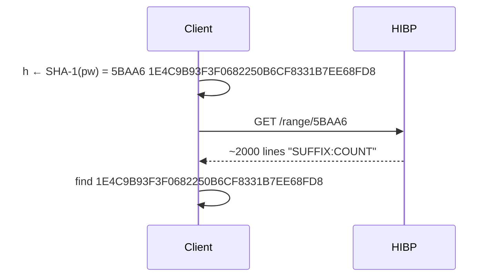

# Comparison: Range API vs Bulk Protocol

## Range API (k-anonymity)

Client sends the first 5 hex chars of `SHA-1(password)`; HIBP returns every suffix in that range.
Client matches locally.

The prefix is sent instead of the hash because a low-entropy password's full hash is trivially
reversed and correlated with the user. 16⁵ ≈ 1 M buckets of ~2000 hashes hide the password among its
bucket.

Measured over 1000 random ranges: median 1971 rows, 75.6 KiB raw, 42.6 KiB gzip.

## Data sizes

`n` = passwords checked. Bodies only, no HTTP headers, no padding. Bulk includes the MAA token (not
yet measured, est. ~3 KiB).

### Request (client → server)

Range API: 5 B prefix in the URL per password. Bulk: attest + handshake + `K_request` B per hash.

| n         | Range API | Bulk (20 B prefix) | Bulk (12 B prefix) |
| --------- | --------- | ------------------ | ------------------ |
| 1         | 5 B       | 180 B              | 172 B              |
| 100       | 500 B     | 2.1 KiB            | 1.3 KiB            |
| 1 000     | 4.9 KiB   | 20 KiB             | 12 KiB             |
| 4 000     | 20 KiB    | 78 KiB             | 47 KiB             |
| 100 000   | 488 KiB   | 1.9 MiB            | 1.1 MiB            |
| 1 000 000 | 4.8 MiB   | 19 MiB             | 11 MiB             |

### Response (server → client)

Range API: ~2000 suffixes per password (gzip). Bulk: statement + MAA token + handshake + 1 bit per
hash.

| n         | Range API (gzip) | Bulk    | Ratio    |
| --------- | ---------------- | ------- | -------- |
| 1         | 43 KiB           | 3.7 KiB | 12×      |
| 100       | 4.2 MiB          | 3.7 KiB | 1 200×   |
| 1 000     | 42 MiB           | 3.8 KiB | 11 000×  |
| 4 000     | 166 MiB          | 4.1 KiB | 41 000×  |
| 100 000   | 4.1 GiB          | 16 KiB  | 270 000× |
| 1 000 000 | 41 GiB           | 126 KiB | 340 000× |

## Properties

|                        | Range API                  | Bulk                             |
| ---------------------- | -------------------------- | -------------------------------- |
| Leaks to server        | 20-bit prefix per password | Nothing (attested)               |
| Leaks vault size       | Exactly (request count)    | Exactly (request size)           |
| Round trips            | n                          | 3                                |
| Trust                  | HIBP / Cloudflare          | AMD SEV-SNP + MAA + image review |
| Runs without our infra | Yes                        | No                               |
