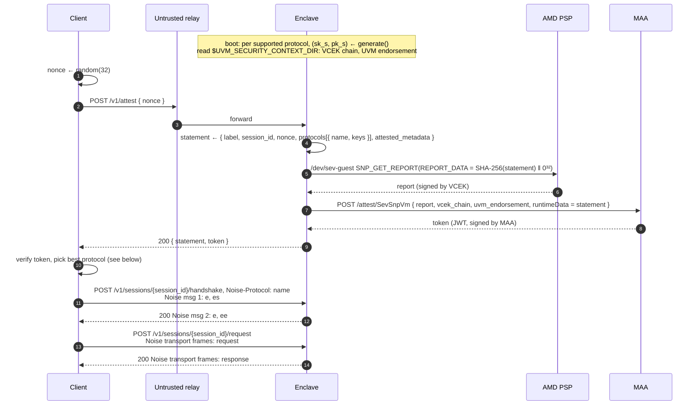
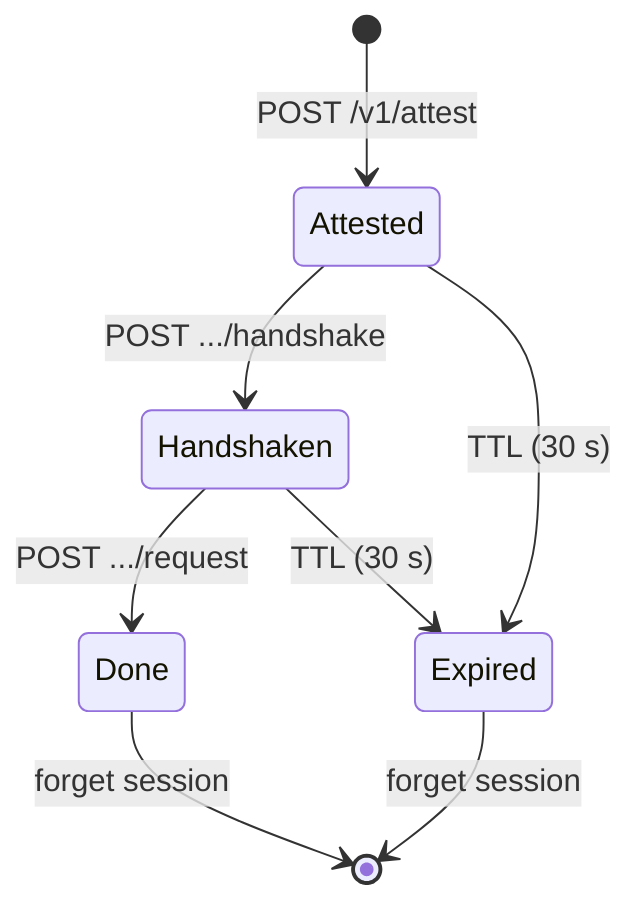

# Enclave Communication Protocol

A protocol for establishing a secure communication channel to an enclave. The channel is end-to-end
encrypted, and attested. The user knows which specific container image they are communicating with.

At boot the enclave generates one Noise static key `s` per supported protocol. `sk_s` never leaves
enclave memory and is gone when the container stops. Each session gets a fresh SNP report over an
enclave metadata statement with these keys, the protocols, the client nonce, and application
metadata. Microsoft Azure Attestation (MAA) verifies the report and returns a signed token, which
the client verifies.

## Flow



Three round trips total: attest, handshake, content. The handshake carries no application data; the
request and response ride in Noise transport messages.

## Enclave metadata statement

The token attests a statement over the keys, protocols, the nonce, and `attested_metadata`. The
client picks the best protocol it supports. `attested_metadata` is a JSON object defined by the
application protocol; this protocol treats it as opaque.

```json
{
  "label": "trusted-compute-communication-v1",
  "session_id": "<base64url, 16 B>",
  "nonce": "<base64url, 32 B, from client>",
  "protocols": [
    {
      "name": "Noise_NK_P256_AESGCM_SHA256",
      "keys": { "s": "<base64url, 65 B SEC1 uncompressed P-256>" }
    }
  ],
  "attested_metadata": { "<application-defined>": "..." }
}
```

## Noise handshake

`Noise_NK_P256_AESGCM_SHA256`

```
NK:
  <- s              pre-message: keys.s of the chosen protocol, attested
  ...
  -> e, es          msg 1: POST .../handshake body, empty payload
  <- e, ee          msg 2: response body, empty payload
  ->                transport frames: POST .../request body
  <-                transport frames: response body
```

Prologue: `statement` bytes, binding the handshake to the attestation.

Why NK:

- **`N`** (initiator): the client has no static key; it has nothing to prove to the enclave.
- **`K`** (responder): `s` is known in advance from the attested statement, so the client knows it
  talks to the enclave securely.

Payload properties (Noise §7.7 levels):

| Payload  | Source | Destination | In practice                                                                             |
| -------- | ------ | ----------- | --------------------------------------------------------------------------------------- |
| Request  | 0      | 5           | Strong forward secrecy (`ee` + `es`); bound to `session_id` and `nonce` via prologue    |
| Response | 2      | 1           | Authenticated from the attested enclave, bound to the handshake via `h`, forward secret |

A recorded request stays secret even if `sk_s` leaks later. An attacker holding a stolen `sk_s` can
still impersonate the enclave actively.

## Transport framing

A Noise message is at most 65535 B, so a request or response may span several transport messages.
Both bodies are a sequence of frames:

```
body   = frame+
frame  = len u16 BE ‖ flag u8 ‖ Noise transport message (len B)
flag   = 0x00 more frames follow, 0x01 last frame
message = EncryptWithAd(ad = len ‖ flag, chunk)    chunk ≤ 65519 B
```

```
request of 150 000 B → 3 frames

[len][0x00][enc(bytes 0..65518)]
[len][0x00][enc(bytes 65519..131037)]
[len][0x01][enc(bytes 131038..149999)]
```

- The sender splits the payload into chunks and encrypts them in order.
- The receiver decrypts in order and concatenates the chunks.
- `len` and `flag` are authenticated as associated data; altering either fails decryption.
- Reordered or dropped frames fail decryption (Noise nonce counter).
- A body without a `0x01` frame, or with bytes after it, is rejected (truncation).

## HTTP API

HTTPS to the edge; the edge forwards to the enclave. Bodies are opaque to the edge except for
routing on `session_id`.

### `POST /v1/attest`

Starts a session: enclave attests its boot keys and the client nonce in the
[enclave metadata statement](#enclave-metadata-statement).

```http
POST /v1/attest
Content-Type: application/json

{ "nonce": "<base64url, 32 B>" }
```

```http
200 OK
Content-Type: application/json

{
  "statement": "<base64url, enclave metadata statement bytes>",
  "token":     "<MAA JWT>"
}
```

### `POST /v1/sessions/{session_id}/handshake`

Runs the Noise handshake with the chosen protocol. Payloads are empty.

```http
POST /v1/sessions/{session_id}/handshake
Noise-Protocol: Noise_NK_P256_AESGCM_SHA256
Content-Type: application/octet-stream

<Noise handshake message 1>
```

```http
200 OK
Content-Type: application/octet-stream

<Noise handshake message 2>
```

### `POST /v1/sessions/{session_id}/request`

Sends the application request over the established channel.

```http
POST /v1/sessions/{session_id}/request
Content-Type: application/octet-stream

<transport frames: request>
```

```http
200 OK
Content-Type: application/octet-stream

<transport frames: response>
```

### Errors

Plain status codes, no body. Nothing secret is in scope: a failed Noise decrypt and a malformed body
return the same code.

| Status                    | When                                                                                                |
| ------------------------- | --------------------------------------------------------------------------------------------------- |
| `400 Bad Request`         | Malformed body or framing, bad nonce length, Noise decrypt failure, `Noise-Protocol` not in session |
| `404 Not Found`           | Unknown, expired or already used `session_id`                                                       |
| `409 Conflict`            | `request` before `handshake`, or `handshake` repeated                                               |
| `413 Content Too Large`   | Body above the application size limit                                                               |
| `429 Too Many Requests`   | Rate limit on `/v1/attest`                                                                          |
| `503 Service Unavailable` | Application not ready, or MAA unavailable                                                           |

## Client verification

The enclave exchanges its SNP report for a Microsoft Azure Attestation (MAA) token. MAA checks the
AMD certificate chain, report signature, TCB, and utility VM endorsement; the client checks the
token.

### Pinned in the client

| Value                                 | Source                                                      |
| ------------------------------------- | ----------------------------------------------------------- |
| MAA instance URL (`iss`)              | Our attestation provider                                    |
| MAA signing keys                      | `GET {iss}/certs` (OpenID metadata), cached                 |
| Container policy hashes (`HOST_DATA`) | Our build: `SHA-256(policy)` from `az confcom acipolicygen` |

### Steps

```
1. token signature      valid under MAA signing key (RS256)
2. iss, exp, nbf        expected instance, not expired
3. x-ms-attestation-type        == "sevsnpvm"
4. x-ms-compliance-status       == "azure-compliant-uvm"
5. x-ms-sevsnpvm-is-debuggable  == false
6. x-ms-sevsnpvm-reportdata     == SHA-256(statement) ‖ 0³²; label, own nonce
7. x-ms-sevsnpvm-hostdata       ∈ policy hash allowlist
8. chosen protocol              in statement with exactly its keys
```

1–2: token from our MAA instance. 3–5: genuine, compliant, non-debug SNP utility VM (checked by
MAA). 6: statement and freshness. 7: container policy, which pins image layers. 8: channel.

Any failure aborts before application data leaves the client.

Optional: verify MAA itself. Its signing certificates embed MAA's own SNP report; check its
`HOST_DATA` against values from Microsoft and its builds in
[Microsoft Signing Transparency](https://learn.microsoft.com/en-us/azure/confidential-ledger/about-microsoft-signing-transparency-ledger).

## Server session state



## Open

- Policy hash allowlist delivery: pinned in client releases or a signed list?
- One PSP report and one MAA call per `/v1/attest`. Latency, MAA rate limits, own attestation
  provider vs shared regional instance?
- Confirm MAA's `REPORT_DATA` convention for `runtimeData` (`SHA-256 ‖ 0³²`).
- Key lifetime: rotate `s` without restart (e.g. daily) to bound request exposure?
- Multiple enclave instances: edge needs session affinity on `session_id` (e.g. instance id encoded
  in it).

## Appendix A: FIPS

All security functions are FIPS approved; both ends call a CMVP-validated module (e.g. aws-lc-rs
`fips`, WebCrypto).

| Noise slot        | Function                   | Standard                      |
| ----------------- | -------------------------- | ----------------------------- |
| DH                | ECDH P-256                 | SP 800-56A                    |
| Cipher            | AES-256-GCM, counter nonce | SP 800-38D (deterministic IV) |
| Hash / KDF        | SHA-256, HMAC two-step KDF | FIPS 180-4, SP 800-56C        |
| Attestation token | RS256 (MAA JWT)            | FIPS 186-5                    |

`P256` is not a standard Noise DH name; this spec defines it:

- Public key: SEC1 uncompressed, 65 B.
- DH output: x-coordinate of the shared point, 32 B.
- Peer keys get full public key validation (SP 800-56A §5.6.2.3.3).

Note:
[FedRAMP Policy for Cryptographic Module Selection and Use v1.1](https://www.fedramp.gov/resources/documents/FedRAMP_Policy_for_Cryptographic_Module_Selection_v1.1.0.pdf)
requires only one validated layer when layers stack. Noise over validated TLS would comply with
unvalidated Noise primitives. We do not rely on this; Noise stays FIPS approved independent of
transport.
