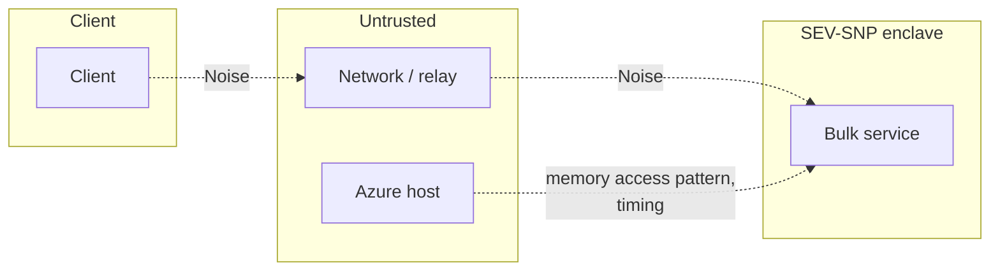

# HIBP Bulk Protocol — Security Definitions

## Actors

| Actor                                     | Trust                                           |
| ----------------------------------------- | ----------------------------------------------- |
| Client                                    | Trusted                                         |
| Enclave code (attested image)             | Trusted                                         |
| AMD SEV-SNP / PSP                         | Trusted                                         |
| Microsoft utility VM (signed endorsement) | Trusted to enforce the container policy         |
| Microsoft Azure Attestation (MAA)         | Trusted to verify SNP evidence honestly         |
| Azure host, hypervisor, operator          | Untrusted                                       |
| Relay / network                           | Untrusted                                       |
| HIBP                                      | Untrusted; wrong data only yields wrong results |

## Assets

| Asset           | Why                                              |
| --------------- | ------------------------------------------------ |
| Password hashes | Low-entropy passwords are recoverable from SHA-1 |
| Per-hash result | Tells which vault items are weak                 |

## Trust boundaries

## Goals

- **SG1 Query confidentiality** — no party outside the enclave learns a submitted hash.
- **SG2 Result confidentiality** — no party outside the enclave learns a result.
- **SG3 Result integrity** — client only accepts results computed by the attested image.
- **SG4 Freshness** — a replayed attestation or session is rejected.
- **SG5 Forward secrecy** — later compromise of the enclave, including its boot key `sk_s`, does not
  reveal past sessions.

## Assumptions

- SEV-SNP memory encryption and report signing hold.
- The CCE policy pins the exact image; the image is reviewed.
- Microsoft's endorsed utility VM enforces the CCE policy.
- MAA verifies SNP evidence correctly and signs only what it verified. Its code is closed; builds
  are logged in Microsoft Signing Transparency.

## Accepted leakage

| Observer        | Learns                                               |
| --------------- | ---------------------------------------------------- |
| Network / relay | Session timing, batch size (= vault size)            |
| Host            | Above + memory access pattern (see bulk proto, open) |

## Non-goals

- Hiding that a user runs a health report.
- Hiding vault size (batch size is visible).
- Correctness of the HIBP dataset (cache fill integrity).
- Availability against the host (it can drop sessions).
- TEE side channels beyond the access-pattern decision.
