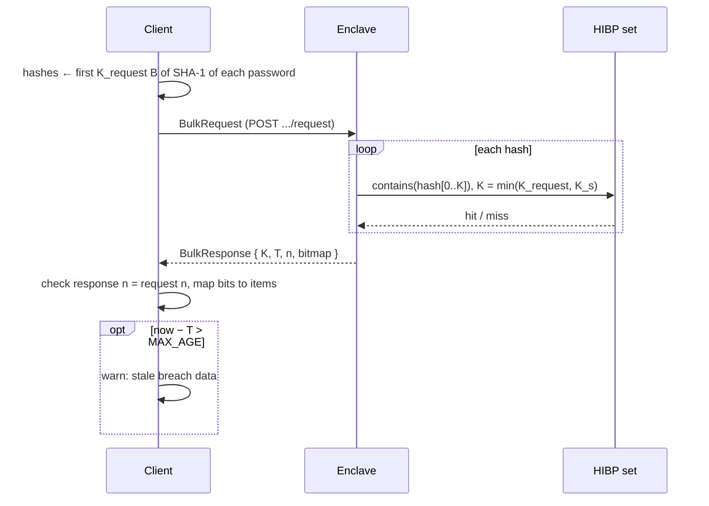

# HIBP Bulk Protocol

Batch query / response carried inside the Noise channel from
[enclave-comms-proto.md](enclave-comms-proto.md). One request, one response per session.

## Messages

Fixed-width binary, little-endian.

```
BulkRequest
+----------+----------+------------------------------------+
| K  u32   | n  u32   | hash[n]  (first K B of SHA-1 each) |
+----------+----------+------------------------------------+

BulkResponse
+----------+----------+----------+------------------------+
| K  u32   | T  u64   | n  u32   | bitmap u64[⌈n / 64⌉]   |
+----------+----------+----------+------------------------+
```

| Field          | Meaning                                                                       |
| -------------- | ----------------------------------------------------------------------------- |
| `K` (request)  | Bytes sent per hash, 1–20                                                     |
| `n`            | Batch size; response `n` must equal request `n`                               |
| `hash[i]`      | First `K` bytes of `SHA-1(UTF-8(password))`                                   |
| `K` (response) | Bytes compared: `min(K_request, K_s)` (see [Prefix lengths](#prefix-lengths)) |
| `T`            | Unix timestamp (s) of the last cache refresh                                  |
| `bitmap`       | Bit `i` set ⇔ `hash[i]` is pwned                                              |

Bit `i` lives in `bitmap[i / 64]` at bit position `i % 64` (LSB first):

```
hits at i = 0, 2, 65   (n = 66)

bitmap[0] = 0b...0101   = 5
bitmap[1] = 0b...0010   = 2
```

## Parameters

### Prefix lengths

Client and enclave each pick a prefix length; they compare on the longest prefix both have:

```
K_request  client setting, bytes sent per hash      (1–20)
K_s        service setting, bytes stored per entry  (1–20)
K          = min(K_request, K_s), bytes compared, reported in response
```

Recommended: `K_s = 12` and `K_request = 12` (bytes beyond `K_s` are never compared). Either side
changes its length without a protocol version bump. A false positive is a non-pwned hash whose first
`K` bytes match a stored entry:

```
FP(K) = 1 − exp(−M / 2^(8K))  ≈  M · 2^(−8K)

M = 2.07 × 10⁹   lookup against whole set
M = 1971         lookup within 5-nibble bucket (median rows per range)
```

| `K`  | Set size | FP whole set | FP bucketed |
| ---- | -------- | ------------ | ----------- |
| 6 B  | 12.4 GB  | 7.3 × 10⁻⁶   | 7.0 × 10⁻¹² |
| 8 B  | 16.5 GB  | 1.1 × 10⁻¹⁰  | 1.1 × 10⁻¹⁶ |
| 12 B | 24.8 GB  | 2.6 × 10⁻²⁰  | 2.5 × 10⁻²⁶ |
| 16 B | 33.1 GB  | 6.1 × 10⁻³⁰  | 5.8 × 10⁻³⁶ |
| 20 B | 41.3 GB  | 0 (exact)    | 0 (exact)   |

Target: `FP < 10⁻⁹` (under one false positive per year at 10⁹ queries). Plot:
[plots/fp_rate.png](plots/fp_rate.png). RAM sizing: [Appendix A](#appendix-a-ram-sizing).

### Attested metadata

When running in an enclave, the service sets `attested_metadata` in the
[enclave metadata statement](enclave-comms-proto.md#enclave-metadata-statement):

```json
{
  "cache_refreshed_at": 1793145600,
  "stored_prefix_bytes": 12
}
```

| Field                 | Meaning                                                                |
| --------------------- | ---------------------------------------------------------------------- |
| `cache_refreshed_at`  | Unix timestamp (s) of the last HIBP lookup that filled the cache (`T`) |
| `stored_prefix_bytes` | `K_s`                                                                  |

The client learns both before sending any hash, attested by the report.

### Maximum cache age `MAX_AGE`

Client setting. If `now − T > MAX_AGE` the client still shows results but warns that the breach data
is stale. Default: 7 days.

## Errors

Mapped onto [enclave-comms-proto.md](enclave-comms-proto.md#errors):

| Status                    | When                                           |
| ------------------------- | ---------------------------------------------- |
| `400 Bad Request`         | `K` outside 1–20, or body length ≠ `8 + n · K` |
| `503 Service Unavailable` | Cache not loaded yet                           |

## Flow



## Open

- Lookup side channel: SEV-SNP does not hide memory access patterns from the host
  ([implementation-guidance.md](implementation-guidance.md#oblivious-lookups)). Options:
  - Scan the whole 5-nibble bucket per hash → host learns at most the prefix, same as the public
    range API.
  - Oblivious lookup (ORAM / sort-merge) → nothing leaks, higher cost.

## Appendix A: RAM sizing

Largest `K_s` that fits, per container RAM. Assumes 2 GB reserved for OS and service. "Refresh"
holds old and new set side by side.

| RAM    | `K_s` | FP whole    | FP bucketed | `K_s` refresh | FP whole    | FP bucketed |
| ------ | ----- | ----------- | ----------- | ------------- | ----------- | ----------- |
| 16 GB  | 6 B   | 7.3 × 10⁻⁶  | 7.0 × 10⁻¹² | 3 B           | ≈ 1         | 1.2 × 10⁻⁴  |
| 24 GB  | 10 B  | 1.7 × 10⁻¹⁵ | 1.6 × 10⁻²¹ | 5 B           | 1.9 × 10⁻³  | 1.8 × 10⁻⁹  |
| 32 GB  | 14 B  | 4.0 × 10⁻²⁵ | 3.8 × 10⁻³¹ | 7 B           | 2.9 × 10⁻⁸  | 2.7 × 10⁻¹⁴ |
| 48 GB  | 20 B  | 0           | 0           | 11 B          | 6.7 × 10⁻¹⁸ | 6.4 × 10⁻²⁴ |
| 64 GB  | 20 B  | 0           | 0           | 14 B          | 4.0 × 10⁻²⁵ | 3.8 × 10⁻³¹ |
| 128 GB | 20 B  | 0           | 0           | 20 B          | 0           | 0           |
