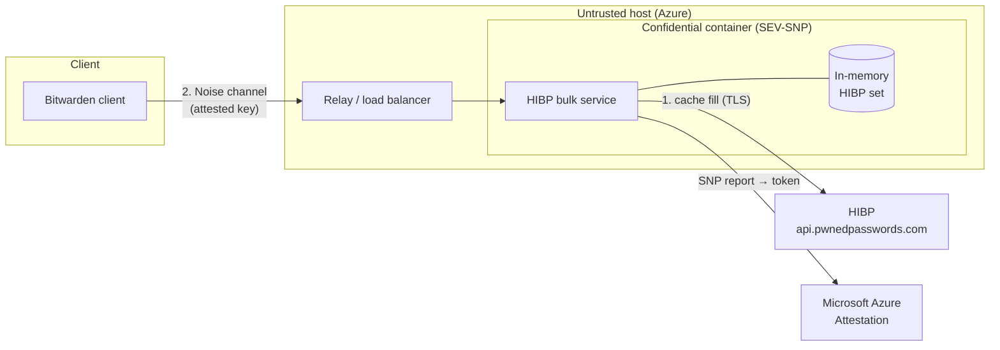
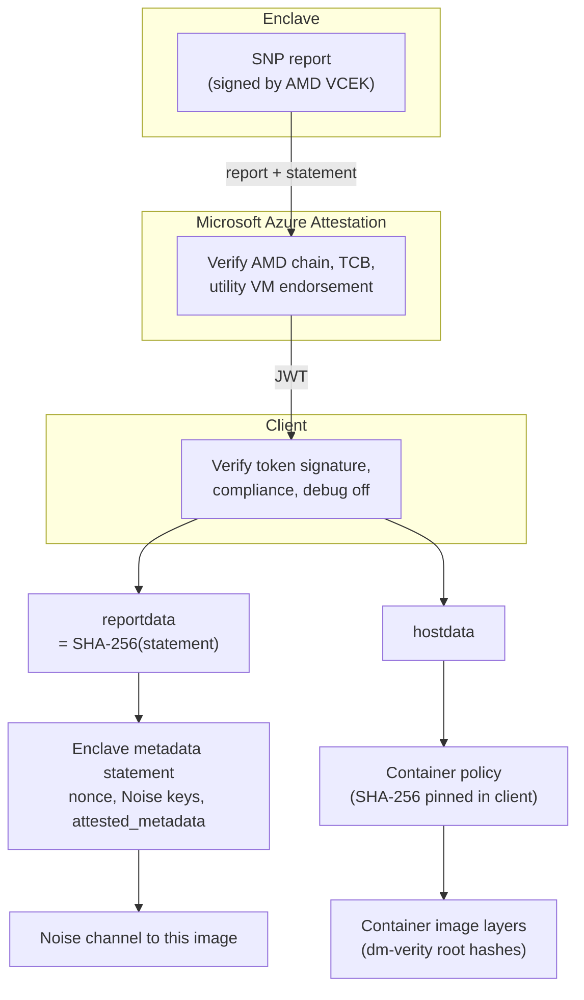
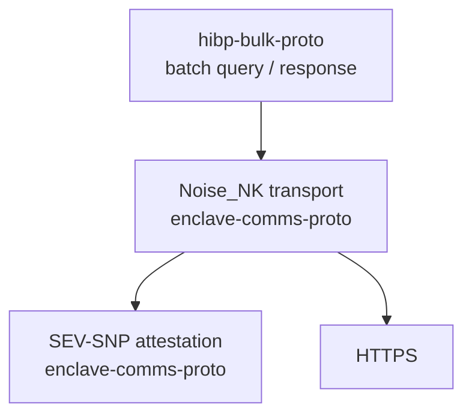

# HIBP Bulk Protocol — Overview

## Introduction

### Problem

Clients check many passwords against Have I Been Pwned (HIBP), e.g. every item in a vault health
report.

Sending the full `SHA-1(password)` would reveal the password: low-entropy passwords are recovered
from their hash by dictionary attack, and the query links them to the user. HIBP's range API
therefore takes only a 5-nibble prefix and returns every suffix in that range (k-anonymity):

```
SHA-1("password") = 5BAA6 1E4C9B93F3F0682250B6CF8331B7EE68FD8
                    └───┘ sent   └── matched locally against ~2000 suffixes
```

Each lookup costs ~43 KiB (gzip) and still leaks 20 bits per password. 100 000 passwords → ~4.1 GiB,
100 000 round trips.

### Solution

A batch lookup protocol to a service in an attested enclave (Azure Confidential Container, AMD
SEV-SNP). The client sends full hashes in one batch; the enclave answers with one bit per hash. Only
attested code sees the hashes, so no prefix trick is needed.

100 000 passwords → ~1.1 MiB up (12 B prefix), ~16 KiB down, 3 round trips. See
[comparison.md](comparison.md).

## Phases

1. **Cache fill** — enclave downloads the full HIBP dataset into memory.
2. **Query** — clients send batches of hashes, enclave answers per hash. Modelled in
   [hibp-bulk-proto.md](hibp-bulk-proto.md).



## Attestation

The enclave's SNP report is verified by Microsoft Azure Attestation (MAA); the client verifies MAA's
token.



Details: [enclave-comms-proto.md](enclave-comms-proto.md#client-verification).

## Layering


